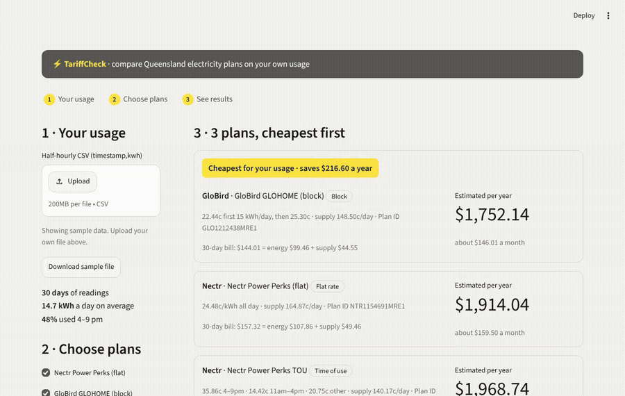
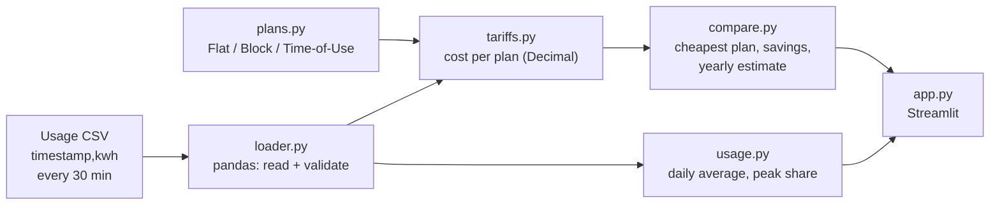

# TariffCheck ⚡

[](https://github.com/vy-trg/tariffcheck/actions/workflows/ci.yml)

Find the cheapest Queensland electricity plan for how you actually use power.

**Live demo:** https://tariffcheck.streamlit.app/



## The problem

Households in Queensland can choose from dozens of electricity plans, but each one charges differently: a flat rate, stepped (block) rates, or different prices by time of day.
Which plan is cheapest depends on *when* and *how much* you use power, not just the headline rate.
Comparison sites ask for a rough yearly total, so they can't tell whether your evening-heavy usage suits a time-of-use plan.
TariffCheck takes your real half-hourly usage from your meter data, prices it under each plan, and shows the cheapest plan, how much you'd save, and a yearly estimate.

## How to use it

1. Open the [live app](https://tariffcheck.streamlit.app/). It starts with 30 days of sample data.
2. Upload your own CSV with two columns, `timestamp,kwh`, one row per half hour (e.g. `2026-10-01 18:30,0.25`). The **Download sample file** button shows the format.
3. Tick the plans to compare. The cheapest one is marked, with the yearly saving.

Run it locally:

```bash
python3.12 -m venv .venv && source .venv/bin/activate
pip install -r requirements.txt
streamlit run app.py      # the app
python -m pytest          # 82 tests
```

## Architecture



- All money is `Decimal`, rounded to cents only at the end, so totals never drift.
- `app.py` only displays results. Every dollar comes from `compare.py`, which is fully tested.
- Design decisions and assumptions: [`docs/design.md`](docs/design.md). Testing: [`docs/test-plan.md`](docs/test-plan.md).

## Limitations

- Three real plans only (Nectr flat, GloBird block, Nectr time-of-use), with prices from 9 Nov 2026. Prices change, so check Energy Made Easy before switching.
- The yearly figure scales your file up to 365 days. A summer file will not reflect winter use.
- No solar feed-in, demand charges, discounts, concessions or GST rounding.
- The sample data is generated (`scripts/generate_data.py`), not a real household.

## Sources

- Plan prices: [Energy Made Easy](https://www.energymadeeasy.gov.au/) (Australian Government), plan IDs in `docs/design.md`.
- Typical Queensland usage for sanity checks: Energy Made Easy "medium usage" benchmarks.

---

Inspired by a university group project; independently designed and built.
