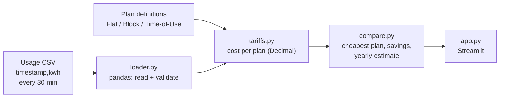

# TariffCheck ⚡

Find the cheapest Queensland electricity plan for how you actually use power.

## The problem

Households in Queensland can choose from dozens of electricity plans, but each one charges differently: a flat rate, stepped (block) rates, or different prices by time of day.
Which plan is cheapest depends on *when* and *how much* you use power, not just the headline rate.
Comparison sites ask for a rough yearly total, so they can't tell whether your evening-heavy usage suits a time-of-use plan.
TariffCheck takes your real half-hourly usage from your meter data, prices it under each plan, and shows the cheapest plan, how much you'd save, and a yearly estimate.

## Architecture

## Status

🚧 In progress. See the [project board](https://github.com/vy-trg/tariffcheck/projects) for what's next.